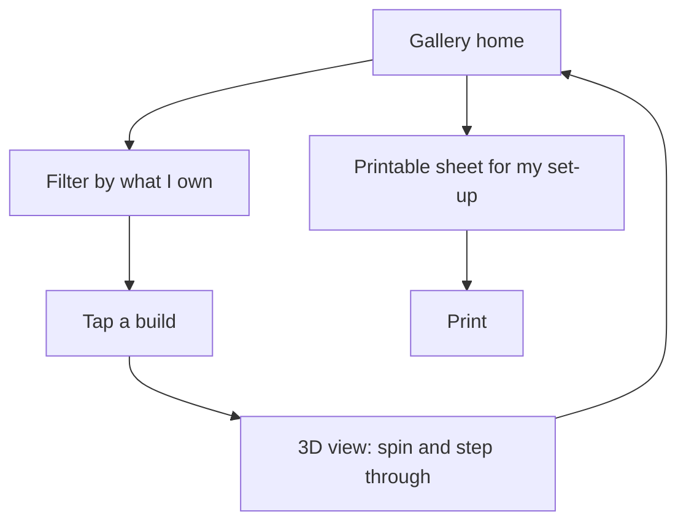
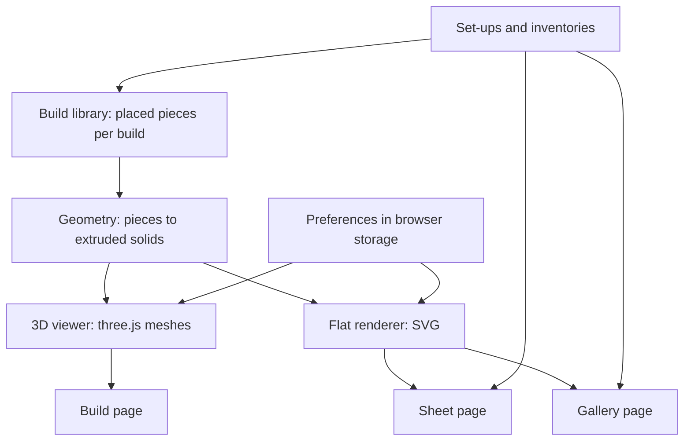

# Couch Coach Gallery Site - Plan

## Goal Capsule

- **Objective:** A parent who arrives at Couch Coach for the first time lands on a site that looks finished: a full wall of play-couch builds they can filter to what they own, open in 3D, and print.
- **Means:** Three static pages that share one build library (KTD1, KTD2).
- **Product authority:** The site owner. This plan covers the build library, the gallery home page, the 3D view, and moving the printable sheet to its own page. Card swapping, share links, the drag configurator, other brands, and anything that earns money are not active scope.
- **Authority order:** Requirements decide product behaviour. Key Technical Decisions decide mechanism within the requirements they cite. A unit overrides neither.
- **Execution profile:** One change set, delivered as a single pull request or its local equivalent. The project has no version control yet; U1 starts it.
- **Stop conditions:** Stop and ask the owner if a requirement would have to change, or if a build cannot be expressed in the shared build description (KTD2).
- **Who finishes:** The implementing agent builds and verifies. The owner reviews in a real browser and reports which builds have been tried with a child.
- **Open blockers:** None.

---

## Product Contract

**Product Contract preservation:** changed: added R18 and R19, both confirmed by the owner during planning. R1 to R17 are unchanged.

### Summary

Couch Coach becomes a gallery-first site. The home page is a filterable wall of roughly 36 hand-made builds across three couch set-ups. Each build opens in a 3D view that can be rotated and stepped through, and the existing printable sheet moves to its own page and draws from the same builds.

### Problem Frame

Couch Coach today is a single page: a printable sheet of 12 builds for one couch plus the round add-on. It works for the owner's household, but it has no front door. A parent arriving from a short video would see a print tool with colour pickers and no sense of what the site is or how much is in it.

Play-couch build ideas already exist as blog posts and free posters. What those do not offer is something tailored to the couches a family owns, in their colours, that they can look at from every side before building.

### Key Decisions

- **The next month is judged by a finished-looking site.** (session-settled: user-directed — chosen over ranking by videos that pull viewers: the owner's stated priority for the next month)
- **The home page is a gallery of builds.** Governs R6, R7, R9. (session-settled: user-directed — chosen over the 3D couch as the home page, a landing page with two doors, and a what-do-you-own wizard: picked from four sketches)
- **The 3D piece ships as a viewer.** Governs R11, R12, R13. (session-settled: user-approved — chosen over a remix mode and a full drag configurator: smallest version that still impresses)
- **Three set-ups at launch, including two couches.** Governs R1, R4. (session-settled: user-directed — chosen over covering only the set-ups the owner can test at home: bigger audience)
- **Builds are made by hand in advance.** Governs R17. (session-settled: user-approved — chosen over generating builds per visitor: keeps running cost at zero)
- **Print stays flat; 3D lives only in the viewer.** Governs R16. (session-settled: user-approved — chosen over printing from the 3D view: the flat drawings print sharper)

### Requirements

**Build library**

- R1. The library holds builds for three set-ups: one couch, one couch plus the round add-on, and two couches.
- R2. Each set-up has about 12 builds at launch.
- R3. Every build has a name, a set-up, and a theme: things that go, forts, or climb and slide.
- R4. A build that has not been tried with a real child is labelled "not yet kid-tested" wherever it appears.
- R5. The 12 existing builds remain in the library.

**Gallery home page**

- R6. The home page is the gallery of builds.
- R7. A visitor can filter the gallery by theme and by what they own, and the owned filter shows every build they can make with those pieces.
- R8. Couch colours chosen once apply to the gallery, the 3D view, and the printable sheet.
- R9. Tapping a build opens its 3D view.
- R10. The gallery is comfortable to use on a phone.
- R18. A two-couch household can set a different colour for each couch.
- R19. The site's own wording says "play couch" and "round add-on", with one line naming the products it fits.

**3D view**

- R11. A visitor can rotate and zoom the build.
- R12. A step-through shows the pieces going together in order.
- R13. Pieces cannot be moved or edited in this version.

**Printable sheet**

- R14. The sheet lives on its own page, reachable from the gallery, and keeps its current behaviour: 12 cards, the child's name, couch colours, and a double-sided US Letter print.
- R15. The sheet shows the 12 builds made for the visitor's chosen set-up.
- R16. The printed sheet uses the flat drawings.

**Running cost**

- R17. No feature adds a cost per visitor: everything runs in the visitor's browser.

### Key Flows

- F1. First visit from a video
  - **Trigger:** A parent taps through from a short video on their phone.
  - **Steps:** They land on the gallery. They pick what they own. They tap a build and spin it in 3D, then step through how it goes together. They open the printable sheet for their set-up and print it.
  - **Outcome:** They leave with a sheet of builds they can make with their own couch.
  - **Covered by:** R6, R7, R9, R11, R12, R14, R15



### Acceptance Examples

- AE1. **Covers R7.** Given a visitor who picks "one couch plus the round add-on", when the gallery filters, then it shows builds for one couch and builds for one couch plus the add-on, and no two-couch builds.
- AE2. **Covers R4.** Given a two-couch build nobody has tried with a child, when it appears on a gallery card, in the 3D view, or on a printed sheet, then it carries the "not yet kid-tested" label.
- AE3. **Covers R8.** Given a visitor who sets their couch colour in the gallery, when they open a build in 3D and then the printable sheet, then both show that colour without asking again.
- AE4. **Covers R15.** Given a visitor whose set-up is two couches, when they open the printable sheet, then all 12 cards are two-couch builds.

### Success Criteria

- A first-time visitor on a phone can tell from the first screen what the site offers.
- The gallery looks full at launch, with no set-up showing a sparse row.
- Every published one-couch and one-couch-plus-add-on build has been tried at home.

### Scope Boundaries

- Swapping, locking, or shuffling individual cards on the sheet.
- A shareable link for a build or a sheet.
- Moving, swapping, or free-dragging pieces in 3D.
- Play-couch brands with different piece shapes.
- Email sign-up, affiliate links, ads, and paid packs.
- Accounts and anything saved outside the visitor's browser.

**Considered and not built**

- An automatic check that a build can physically stand, that pieces do not pass through each other, or that a folded piece stays joined at its hinge. The "not yet kid-tested" label (R4) carries that risk. Repeated reports of published builds that cannot be made would change this.
- A browser test framework. The pure logic is tested in Node and the pages are checked by rendering them (KTD9). A regression that the render checks miss would change this.

<!-- ce-section: work-relationships -->
### How This Work Fits Together

This plan covers the gallery site: the library, the gallery home page, the 3D viewer, and the sheet's move to its own page. The breakdown below is the current understanding, not a committed roadmap.

- Sheet card controls: swap one card, lock favourites, shuffle the rest, add a build from the gallery.
  - Depends on the build library in this plan.
- Shareable link per build.
  - Depends on each build having its own 3D view.
  - Enables short videos to send viewers to a specific build.
- Remix mode, then a full drag configurator.
  - Depends on the 3D viewer.
  - Still to decide: whether builds made there can join the public library.
- Other play-couch brands.
  - Shares the set-up filter from this plan.
- Email, affiliate links, and paid packs.
  - Can proceed independently of the items above, but need traffic first.

### Dependencies / Assumptions

- The 12 existing builds were designed from piece dimensions and had not been tried with a child when this was written. If that first try shows builds that fall over or drawings that cannot be read, fixing those comes before making more.
- The owner is assumed not to own a second couch, so two-couch builds launch untested. This is unverified.
- Twelve builds per set-up is a guess at what makes the gallery look full.
- The owner expects the 3D view to be built with three.js.
- Piece sizes come from the manufacturer's product pages.

### Sources / Research

- `index.html` holds the current printable sheet, the flat drawing code, and the 12 existing builds.
- Piece dimensions: https://nuggetcomfort.com/pages/product-info and https://nuggetcomfort.com/products/chunk-koala
- Existing build-idea content the site sits beside: https://nuggetcomfort.com/blogs/play/coloring-sheets-build-guides and https://celebratingwithkids.com/?p=1498

---

## Planning Contract

### Key Technical Decisions

- KTD1. **Plain static files with native browser modules, and no build tooling or framework.** Any free static host can serve it. Governs R17. Browser modules do not load from a file opened directly, so local preview runs through a simple static server.
- KTD2. **One build description, two renderers.** A build is an ordered list of placed physical pieces. The shared geometry module, `js/pieces.js`, turns that list into extruded solids, each a 2D profile pushed along one axis, and both the flat renderer and the 3D viewer consume those solids. This is the model the current `extrude()` function in `index.html` already uses, so the flat renderer keeps its logic and the 3D viewer gets the same shapes. Governs R8, R11, R16.
- KTD3. **The step-through follows list order, one step per physical piece.** A folded base is two solids but one step. Governs R12.
- KTD4. **Gallery cards and the sheet use the flat drawings; three.js loads only on the build page.** Governs R10, R16. (session-settled: user-approved — chosen over live 3D previews on every card: keeps the home page quick on phones)
- KTD5. **Each build has its own address: the build page takes the build's id in its query string.** Governs R9.
- KTD6. **three.js is kept inside the project at a pinned version.** Governs R17. (session-settled: user-approved — chosen over loading it from a public CDN: no dependence on someone else's server)
- KTD7. **A set-up is an inventory of physical pieces.** Each build declares its set-up, a check confirms the build uses no more pieces than that inventory holds, and the owned filter shows builds whose set-up inventory fits inside what the visitor owns. Governs R1, R7, R15.
- KTD8. **Preferences live in the visitor's browser storage and are shared by all three pages.** Colours, the child's name, and the chosen set-up keep the existing `cc-` key prefix. Governs R8, R18.
- KTD9. **Pure logic is tested with Node's built-in test runner; pages are checked by rendering them.** The library, set-ups, geometry, flat renderer, and step grouping are modules with no browser dependency, so they run in Node with no added packages.
- KTD10. **Emoji never go inside SVG text.** Doing so makes Chrome's PDF export fail, which the current code already works around with HTML inside the drawing.

### High-Level Technical Design



The geometry module, `js/pieces.js`, is the only place that knows piece sizes and how a placed piece becomes solids. The flat renderer tessellates and depth-sorts those solids as it does today. The 3D viewer extrudes the same profiles into meshes, using one shared mapping from the library's axes to three.js axes.

### Output Structure

```text
index.html            gallery home page
build.html            3D view of one build
sheet.html            printable sheet
css/site.css          shared look, gallery, build page
css/sheet.css         sheet and print rules
js/pieces.js          piece sizes, placement helpers, pieces to solids
js/builds.js          the build library
js/setups.js          set-ups, inventories, owned filter
js/flat.js            flat SVG renderer
js/prefs.js           colours, name, set-up in browser storage
js/gallery.js         gallery page behaviour
js/sheet.js           sheet page behaviour
js/steps.js           groups a build's solids into steps, no browser dependency
js/build-page.js      build page behaviour, drives the step-through
js/viewer3d.js        solids to three.js meshes, camera, controls
vendor/three/         pinned three.js module and orbit controls
tests/                Node tests for the pure modules
package.json          marks the project as modules and names the test command
```

### Risks

- **The 3D view and the flat drawing disagree on orientation.** The library is z-up and left-handed, with x running down-right and y down-left on screen. three.js is y-up and right-handed, so the shared mapping swaps the library's y and z and is not a rotation; a rotation would mirror every build. One shared axis mapping in `js/viewer3d.js`, a test of that mapping, and a side-by-side look at each primitive closes this.
- **Drawing 36 cards is slow on a phone.** The flat renderer compares every pair of tiles in a build. Drawing each card only when it scrolls into view keeps the first screen fast.
- **Authoring 24 new builds is the largest part of the work and is done from dimensions.** Each one is rendered and looked at before it is kept, and R4's label covers what looking cannot.
- **The 3D page cannot be fully verified without a real browser.** Headless Chrome may not provide WebGL, so the owner's review in a browser is part of done.

### Deferred to Implementation

- The exact three.js version to pin.
- The names and designs of the 24 new builds, kept to roughly four per theme in each set-up.
- Whether leaning and upright placements need helpers beyond those `index.html` already has.

---

## Implementation Units

### U1. Version control and shared modules, with the sheet unchanged

- **Goal:** The project is under version control, the single page is split into shared modules, and the printable sheet works exactly as before from its own page.
- **Requirements:** R5, R14, R16, R17. KTD1, KTD2, KTD8, KTD10.
- **Dependencies:** None.
- **Files:** `.gitignore`, `package.json`, `sheet.html`, `css/sheet.css`, `js/pieces.js`, `js/builds.js`, `js/flat.js`, `js/prefs.js`, `js/sheet.js`, `index.html`, `tests/pieces.test.js`, `tests/flat.test.js`, `tests/prefs.test.js`
- **Approach:**
  1. Start version control and commit the current `index.html` untouched as the baseline.
  2. Move piece sizes and placement helpers into `js/pieces.js`, changed to return solids instead of drawing tiles.
  3. Rewrite the 12 builds in `js/builds.js` as ordered lists of placed physical pieces, each with an id, name, and theme.
  4. Move tessellation, depth sorting, shading, and SVG output into `js/flat.js`, taking solids as input.
  5. Move the sheet markup, styles, and behaviour to `sheet.html`, `css/sheet.css`, and `js/sheet.js`.
  6. Leave `index.html` as a short page linking to the sheet until U5 replaces it.
- **Execution note:** Capture the sheet as a PDF before the split and compare it with the PDF after; the drawings should match.
- **Patterns to follow:** `extrude()`, `sortTiles()`, and `drawBuild()` in the baseline `index.html`.
- **Test scenarios:**
  - Each of the 12 builds converts to solids without error and yields at least one solid per placed piece.
  - Depth sorting any of the 12 builds finishes with no unresolved ordering cycle.
  - The SVG for a build with stickers contains no emoji inside a text element.
  - A flat base placed along x and one placed along y produce solids with swapped length and depth.
  - A stored colour is read back by the preferences module, and a missing or blocked store falls back to the default colours.
- **Verification:** The test command passes. `sheet.html`, served locally, prints to a two-page US Letter PDF whose drawings match the baseline.

### U2. Set-ups, inventories, and the kid-tested flag

- **Goal:** The library knows the three set-ups, every build declares one, and a build cannot use pieces its set-up lacks.
- **Requirements:** R1, R3, R4, R7. KTD7. AE1.
- **Dependencies:** U1.
- **Files:** `js/setups.js`, `js/builds.js`, `tests/setups.test.js`, `tests/library.test.js`
- **Approach:** Define the three inventories in `js/setups.js`. Tag the existing 12 builds as one couch plus round add-on, with the kid-tested flag off. Give each placed piece a physical piece type so usage can be counted.
- **Test scenarios:**
  - Covers AE1. Owning one couch plus the round add-on returns one-couch builds and one-couch-plus-add-on builds, and no two-couch builds.
  - Owning one couch returns only one-couch builds.
  - Owning two couches returns one-couch and two-couch builds, and no build that needs the round add-on.
  - A build that places three triangle pillows in a one-couch set-up fails the library check, naming the build and the piece.
  - Every build has a unique id, a name, a known set-up, and one of the three themes.
  - A build with the kid-tested flag off reports the "not yet kid-tested" label, and one with it on reports none.
- **Verification:** The library check passes for the existing 12 builds and fails when a build is given an extra piece.

### U3. Twelve one-couch builds

- **Goal:** The library holds 12 builds that need only one couch.
- **Requirements:** R1, R2, R3. KTD2.
- **Dependencies:** U2.
- **Files:** `js/builds.js`, `js/pieces.js`, `tests/library.test.js`
- **Approach:** Author 12 builds using one base, one cushion, and two triangle pillows, about four per theme. Add a placement helper to `js/pieces.js` only when an existing one cannot express a placement.
- **Execution note:** Render every new build to an image and look at it before keeping it; adjust placements that float, overlap, or read badly.
- **Test scenarios:**
  - The library holds exactly 12 builds for the one-couch set-up.
  - Each theme has at least three one-couch builds.
  - Every one-couch build passes the inventory check and sorts with no ordering cycle.
- **Verification:** All 12 render as recognisable builds in the flat drawing, and the tests pass.

### U4. Twelve two-couch builds and a second couch colour

- **Goal:** The library holds 12 two-couch builds, and the second couch can be drawn in its own colour.
- **Requirements:** R1, R2, R3, R18. KTD2, KTD8.
- **Dependencies:** U2.
- **Files:** `js/builds.js`, `js/pieces.js`, `js/flat.js`, `js/prefs.js`, `tests/library.test.js`, `tests/flat.test.js`
- **Approach:** Add colour roles for the second couch's base, cushion, and triangles. Store a second couch colour in preferences, defaulting to the first. Author 12 builds using two bases, two cushions, and four triangle pillows, about four per theme.
- **Execution note:** Render every new build to an image and look at it before keeping it.
- **Test scenarios:**
  - The library holds exactly 12 builds for the two-couch set-up.
  - Every two-couch build passes the inventory check and sorts with no ordering cycle.
  - With two different couch colours set, pieces of the second couch are drawn in the second colour and pieces of the first in the first.
  - With no second colour stored, the second couch is drawn in the first couch's colour.
- **Verification:** All 12 render as recognisable builds with the two couches visibly distinct when their colours differ.

### U5. Gallery home page

- **Goal:** The home page is a wall of build cards a visitor can filter, recolour, and tap.
- **Requirements:** R6, R7, R8, R9, R10, R18, R19. KTD4, KTD5. AE1, AE2, AE3.
- **Dependencies:** U2, U4. Shows its full content once U3 lands.
- **Files:** `index.html`, `css/site.css`, `js/gallery.js`, `tests/gallery.test.js`
- **Approach:**
  1. Replace the placeholder `index.html` with, in this order from the top at phone width: a one-line statement of what the site is that carries the products line from R19, the what-I-own control, the theme filters, and the grid of cards. The first row of cards is visible without scrolling, and the colour controls sit in a control that starts collapsed.
  2. Each card shows the flat drawing, the build name, the theme colour, and the label from R4 when it applies.
  3. Draw a card's picture only when it scrolls into view.
  4. Each card links to the build page with the build's id, and the header links to the sheet.
  5. Show the second couch colour control only when the chosen set-up has two couches.
  6. Keep the filter and card-list logic in functions that take the library and preferences and return what to show, so Node can test them.
- **Patterns to follow:** The card styling and theme colours in the baseline `index.html`.
- **Test scenarios:**
  - Covers AE1. With "one couch plus the round add-on" chosen and no theme filter, the card list holds 24 builds and no two-couch build.
  - Choosing the forts theme with two couches owned returns only fort builds the visitor can make.
  - Covers AE2. A card for a build with the kid-tested flag off includes the "not yet kid-tested" label.
  - A filter combination that matches nothing returns an empty list and a message to show.
  - Each card's link carries that build's id.
  - Covers AE3. A colour saved from the gallery is the colour the preferences module returns to another page.
- **Verification:** Served locally, the page shows a full grid at phone width with no sideways scrolling, filters change the grid, and tapping a card opens the build page for that build.

### U6. Sheet follows the chosen set-up

- **Goal:** The printable sheet shows the 12 builds for the visitor's set-up and marks untested ones.
- **Requirements:** R4, R8, R14, R15, R16, R18, R19. AE2, AE4.
- **Dependencies:** U2, U3, U4.
- **Files:** `sheet.html`, `css/sheet.css`, `js/sheet.js`, `tests/sheet.test.js`
- **Approach:** Read the chosen set-up from preferences and select the builds made for exactly that set-up. Add a set-up control and a link back to the gallery, both hidden in print. Print the R4 label as a small line on the card, not inside the drawing. Build the footer's set-up line and the colour-control labels from the chosen set-up in R19's wording, replacing the fixed "1 Nugget + 1 Chunk", "Nugget color", and "Chunk color" text the sheet carries today.
- **Test scenarios:**
  - Covers AE4. With two couches chosen, the sheet's 12 cards are all two-couch builds.
  - With no set-up stored, the sheet defaults to one couch plus the round add-on.
  - Covers AE2. A card for an untested build carries the label in its printed form.
  - The sheet splits its 12 builds six to a page in library order.
  - With two couches chosen, the footer's set-up line names two play couches and no round add-on, and no label or footer text uses a brand name outside the one line naming the products it fits.
- **Verification:** For each of the three set-ups, `sheet.html` prints to a two-page US Letter PDF with 12 cards and the right builds.

### U7. 3D build page

- **Goal:** A build opens in a 3D view the visitor can spin, zoom, and step through.
- **Requirements:** R4, R8, R9, R11, R12, R13, R18. KTD2, KTD3, KTD4, KTD5, KTD6. AE2, AE3.
- **Dependencies:** U1, U2, U4. Reaches every build once U3 lands.
- **Files:** `build.html`, `css/site.css`, `js/build-page.js`, `js/steps.js`, `js/viewer3d.js`, `vendor/three/`, `tests/steps.test.js`, `tests/viewer-axes.test.js`
- **Approach:**
  1. Add the pinned three.js module and its orbit controls under `vendor/three/`.
  2. In `js/viewer3d.js`, turn each solid into a mesh by extruding its profile, with ring-shaped profiles keeping their hole, and apply one shared axis mapping.
  3. Light the scene simply, add a floor, and frame the camera on the whole build.
  4. Use orbit controls for rotate and zoom by mouse and touch, with no way to select or move a piece.
  5. In `js/build-page.js`, read the build id from the address, show the name and the R4 label, and drive the step-through: back, next, and show all.
  6. Group solids into steps by physical piece in `js/steps.js`, which has no browser dependency so Node can test it.
  7. Keep the axis mapping in a function with no three.js dependency so Node can test it.
  8. Show links back to the gallery and to the printable sheet on the page at all times.
  9. At phone width, fit the 3D view and the step controls on one screen, and keep a drag on the 3D view from scrolling the page.
  10. Show a plain message with a link to the gallery when the id is missing or unknown, and when 3D is not available in the browser.
- **Technical design:** Directional only. A step is the set of solids that share one placed piece; step n shows pieces 1 to n, and the piece added at step n is drawn solid while a caption names it.
- **Test scenarios:**
  - A build with a folded base and two triangle pillows groups into three steps, not four.
  - Step 1 of any build contains only the first placed piece's solids, and the last step contains every solid.
  - An unknown build id resolves to the not-found state.
  - The axis mapping sends the library's x, y, and z unit directions to three.js x, z, and y.
  - Covers AE2. An untested build's page model includes the "not yet kid-tested" label.
  - Covers AE3. The colours the viewer is given come from the preferences module without a prompt.
- **Verification:** In a real browser, a build of each set-up loads, matches its flat drawing from the same angle, rotates and zooms by touch and mouse, and steps through piece by piece. No piece can be dragged. On a phone, the step controls are reachable without scrolling and the gallery link works.

---

## Verification Contract

| Check | How | Applies to |
|---|---|---|
| Pure logic | `node --test tests/` passes with no added packages | U1 to U7 |
| Sheet prints | Serve the folder locally, print `sheet.html` with headless Chrome, and confirm two US Letter pages with `pdfinfo` | U1, U6 |
| Sheet unchanged by the split | Compare the baseline PDF with the post-split PDF by eye | U1 |
| New builds read well | Render each new build to an image and look at it | U3, U4 |
| Gallery on a phone | Screenshot `index.html` at a 390-pixel-wide window; no sideways scroll, full grid | U5 |
| 3D view | Open `build.html` for one build per set-up in a real browser, at desktop width and at a 390-pixel-wide window, and check rotate, zoom, step-through, and the link back to the gallery | U7 |
| No per-visitor cost | Load each page with the network panel open; every request is to the site's own files | U5, U6, U7 |

---

## Definition of Done

- Every requirement R1 to R19 holds, and each acceptance example passes as a test or a recorded check.
- The library holds 36 builds, 12 per set-up, all passing the inventory check.
- The Verification Contract checks all pass, and the owner has opened the gallery, a 3D build, and the sheet in a real browser.
- Every build carries the "not yet kid-tested" label except those the owner has reported as tried.
- The baseline single-page code no longer exists in `index.html`; nothing is duplicated between it and the modules.
- Code from abandoned attempts, unused helpers, and scratch render output are removed from the change set.

---

## Deferred / Open Questions

These are review items left for the owner. They do not block implementation; until the owner answers, the implementer follows the default named in each.

### From 2026-11-18 review

- **What the gallery shows before a visitor says what they own** — U5. Gallery home page (P2, design-lens, confidence 75)

  A first-time visitor has not picked a set-up, and the plan does not say whether the gallery then shows all 36 builds or assumes one couch plus the round add-on as the sheet does. Showing everything looks fullest but includes builds the visitor may not be able to make. Default until answered: show all builds.

- **Cards and the build page do not say which set-up a build needs** — U5. Gallery home page and U7. 3D build page (P2, design-lens, confidence 75)

  The what-I-own filter returns a mix of set-ups, and an unfiltered gallery shows all three, so a visitor cannot tell from a card whether a build needs the round add-on or a second couch. Theme is also shown by colour alone.

  Change: show a short text tag for the build's set-up and its theme name on each card and on the build page.
